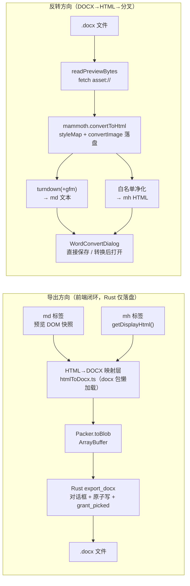

# MkDown 开发方案：Word 导入导出（MD / MH ⇄ DOCX）

> 版本：v0.4（开发方案 · 含原生 mh 格式审验实证，见 §2.1；v0.4 决策见 §0.4）
> 作者：小B；决策/评审：飞总（2026-10-13）
> 日期：2026-10-13
> 范围：在现有 MkDown（md-editor-v3 + wangEditor + CodeMirror 6 + Tauri 2 + Vue3 + Pinia）上增加四项能力
> 1. **R1 导出**：Markdown（`.md`）→ Word（`.docx`）
> 2. **R2 导出**：Markhtml（`.mh`）→ Word（`.docx`）
> 3. **R3 反转**：Word（`.docx`）→ Markdown（`.md`）
> 4. **R4 反转**：Word（`.docx`）→ Markhtml（`.mh`）
> 附带开放（D1 对称性）：**mh → HTML**（`.mh` 导出 `.html`，后缀 html）
> 约束（承接项目既有纪律）：禁网（全部依赖本地打包）、D4 重体积库懒加载、适配层契约（业务层不直接 import 编辑器内核）、磁盘态图片相对路径口径（`./assets/`）。

---

## 0.1 结论摘要

- **技术可行性：成立，且与现有架构同构。** 导出方向 md / mh 在前端都持有 **HTML**；反转方向 docx 已有 `docx-preview` 预览链路。
- **推荐路线（两端各一条统一管线）**：导出 = `HTML → DOCX`（自建映射层 + npm `docx` 包）；反转 = `DOCX → HTML`（mammoth）→ 分叉 turndown（→md）/ 白名单净化（→mh）。
- **入口统一**：顶栏搜索按钮右侧「输出」图标 + hover 下拉（导出 HTML / 导出 Word / 导出 PDF / Word 转 MD / Word 转 MH），按激活标签动态启停，三组呈现。
- **原生 mh 格式已完成审验**（§2.1）：磁盘态 = wangEditor `getHtml()` 序列化输出 + 图片相对路径化，方言特征逐类实证（空段落 `<p><br></p>`、表格无 thead、img 带 `data-href`、a 恒 `target="_blank"` 等），映射层与净化层均按实证口径设计。
- **Rust 侧仅三处小改**：`export_docx`、`save_as` 参数化（ext + initialDir）、图片落盘复用/新增。
- **工作量约 15.7 人日**（分两阶段，导出优先），见 §12。
- **v0.3 评审修正一个 P0 逻辑缺陷**：反转产物「转换后打开」为未保存标签（path=null）时相对路径图片破图；修复 = `draftPath` 意向路径机制（§6.5）。

## 0.2 决策记录（v0.1 → v0.2，飞总 2026-10-13）

| # | 决策 | 落点 |
|---|---|---|
| D1 | 入口统一：右上搜索按钮后一个图标，hover 整合下拉，含导出 HTML / 导出 Word / 导出 PDF / Word 转 MD / Word 转 MH | §9.1 |
| D2 | 导出正文字体基线可设置（中文字体 / 西文字体 / 字号） | §5.3、§9.3 |
| D3 | 反转产物交互：点击后弹出「操作页面」（模态），转换后两操作——**直接保存** / **转换后打开** | §9.2 |
| D4 | 工作区外 docx 图片落盘：补登记同目录，失败降级 data: URL | §6.3 |
| D5 | Mermaid / KaTeX 高保真导出（公式图片化、SVG 直嵌）进本期 | §5.4 |
| D6 | 批量导出本期不做，记录为 P2 候选 | §13 |
| D7 | 转换操作页面预览区显示内容预览（前 ~2000 字符，`<pre>` 纯文本口径） | §9.2 |

## 0.3 评审修订记录（v0.2 → v0.3，方案级评审优化）

> 评审视角：功能逻辑性 + 操作便捷性。V1 为 P0。

| # | 级别 | 发现 | 处置 |
|---|---|---|---|
| V1 | **P0 逻辑缺陷** | 「转换后打开」= 未保存标签（`path=null`）→ `activeDocPath=null`（`Workbench.vue:91`）→ 两引擎均不解析相对路径图片 → **反转产物破图** | `draftPath` 机制，§6.5 |
| V2 | P1 | 预览 DOM 的 hljs token span 泄漏进映射层 | §5.2 扁平化 + 白名单遍历 |
| V3 | P1 | 转换并发/取消语义未定义 | §9.2 并发守卫 + 关闭=放弃 |
| V4 | P1 | 下拉点开一片灰项 | §9.1 三组呈现 + 灰项 tip |
| V5 | P2 | 「直接保存」无初始目录 | §6.3/§7 `save_as` 增 initialDir |
| V6 | P2 | 转换产物标签标题丢来源 | §9.2 标题冠来源 |
| V7 | P2 | 快照恢复丢 draftPath | §6.5 快照同步 |
| V8 | P2 | 字体设置易误解 | §9.3 文案注明仅影响导出 |
| V9 | P2 | 菜单 tip 透出字体基线 | §9.1 |
| V10 | P2 | 取消保存≠取消转换 | §9.2 |
| V11 | P2 | 零提取判定未量化 | §6.2 trim 为空 → 警示条 |
| V12 | P2 | Word 伪标题边界 | §6.2/§11 明示 |
| V13 | P2 | 图片 alt 丢失 | §6.2/§6.4 保留 |
| V14 | 建议 | mh 导出 HTML 顺带开放 | **v0.4 批准，见 D8** |
| V15 | P2 | toast 动作按钮/记住上次操作 | §13 P2 清单 |

## 0.4 v0.4 修订记录（飞总 2026-10-13）

| # | 内容 | 落点 |
|---|---|---|
| D8 | **开放「mh 导出 HTML」**（Q8 批准）：导出来源 = `.mh` 磁盘态 HTML，**导出文件后缀为 `.html`**（`export_html` 的 `default_export_name` 已按 stem + "html" 生成，零 Rust 改动）；`canExportHtml` 放开至 `kind ∈ {md, mh}` | §5.1/§9.1/§11 |
| D9 | **KaTeX foreignObject 序列化失败时先源码降级**（Q6 拍板）：保留 `$...$` 源码 + 汇总 toast，阶段三重评（MathML→OMML 等路线） | §5.4/§10-R2 |
| D10 | **原生 mh 格式审验完成**：写入链路 + 序列化方言逐类实证（bundle 序列化器 + 模板骨架 + 读写链路三源互证），结论成表 | §2.1 |

---

## 1. 需求拆解与边界

| 编号 | 方向 | 输入 | 输出 | 入口 |
|---|---|---|---|---|
| R1 | 导出 | 激活 `.md` 标签 | `.docx` | Toolbar 输出下拉 →「导出 Word」 |
| R2 | 导出 | 激活 `.mh` 标签 | `.docx` | 同上 |
| R3 | 反转 | 预览中的 `.docx` 标签 | `.md` | Toolbar 输出下拉 →「Word 转 MD」→ 转换操作页面 |
| R4 | 反转 | 预览中的 `.docx` 标签 | `.mh` | 同上 →「Word 转 MH」 |
| D8 | 附带 | 激活 `.mh` 标签 | `.html` | 输出下拉 →「导出 HTML」 |

**明确不做（本期边界）**：

- 旧版 `.doc`（OLE）：不支持，提示另存为 `.docx` 后再转。
- 加密 / 损坏 / 非 OOXML zip：错误态提示，不静默产出空文件。
- 超过 32MB 的 docx：复用 `MAX_PREVIEW_BYTES`（`PreviewAssets.ts`）。
- 保真回环：定位「内容级转换」，不承诺逐字节一致。
- 页边距 / 标题样式自定义：本期只开放正文字体基线（D2）。
- 批量导出（D6）；脚注/尾注/目录域/文本框/艺术字/SmartArt 不承诺。
- toast 动作按钮、文件树右键转换入口（V15，避免入口分裂）。

---

## 2. 现状基线（基于源码实证）

| 能力 | 现状 | 证据 |
|---|---|---|
| md 预览 HTML 来源 | ✅ 有 | `MdEditorV3Engine.vue` `@html-changed` → `editor.previewHtml`（`Workbench.vue:1263`） |
| mh 内容形态 | ✅ 原生 HTML | `WangEditorEngine.vue`「.mh 原生 HTML 读写，零转换」；格式审验见 §2.1 |
| HTML 导出链路 | ✅ 有 | `exportApi.exportHtml` → `export_cmd.rs::export_html`（default_name = stem + **html**，`.mh` → `xxx.html` 自动成立，D8）；v0.4 起放开至 md + mh |
| PDF 打印链路 | ✅ 有（md/mh） | 引擎级 `exportPdf()` + `#export-pdf-preview` + `window.print()`；`waitExportPreviewReady`（`MdEditorV3Engine.vue:463`） |
| docx 预览 | ✅ 有 | `docx-preview@0.4.1`；`DocxPreview.vue`；`PreviewKind='docx'\|'xlsx'\|'image'` |
| docx → 文本 | ❌ 缺口 | 预览为视图渲染，无内容抽取 |
| HTML → docx | ❌ 缺口 | 无生成能力 |
| **未保存标签资产基准** | ❌ **断点（V1）** | `activeDocPath = path ?? null`（`Workbench.vue:91`）；两引擎 `docPath=null` 时相对路径图片不解析 |
| Toolbar 输出类按钮 | ⚠️ 两个独立按钮 | `export-html` + `print-pdf`（`Toolbar.vue:353-358`）→ 合并为统一下拉（D1） |
| 设置持久化 | ✅ 有 | `AppSettings` + `DEFAULT_SETTINGS`（`types.ts:78-119`）+ `SettingsDialog` 分区 |
| 模态对话框 | ✅ 有 | `AppDialog.vue` 视觉规范 |
| 另存为 | ⚠️ 硬编码 | `save_as`：filter 硬编码 `"Markdown (*.md)"` + `set_extension("md")` + **无初始目录**（`file_cmd.rs:110`） |
| 会话快照 | ⚠️ 需扩展 | `tabToSnapshot` 显式选字段（`sessionSnapshot.ts:30-40`）；新增 `draftPath` 需同步（V7） |
| 图片口径 | ✅ 统一 | 磁盘态 `./assets/`；显示态 `asset://`；粘贴图 `save_pasted_image` |

## 2.1 原生 mh 格式审验（D10，实证结论）

**审验方法三源互证**：① 写入链路源码（`WangEditorEngine.vue`）；② wangEditor 5.1.23 序列化器 bundle 实证（`node_modules/@wangeditor/editor/dist/index.js` 的 `elemToHtml` 逐类提取）；③ 模板骨架注释（`markdownTemplate.ts:10-13`）。

**写入链路实证**：`onChange → editorRef.getHtml() → htmlToDisk()（asset:// → 相对路径）→ emit → tab.content → write_file_atomic`（`WangEditorEngine.vue:224-229`）。
**结论：磁盘态 `.mh` = wangEditor `getHtml()` 序列化输出 + 图片相对路径化。** 无 `<html>/<head>/<body>` 骨架，无 `data-w-e-type` 标记（todo 例外）。

| 结构 | 序列化实证 | 对映射层（→docx）/ 净化层（→mh）的含义 |
|---|---|---|
| 标题 | `<h1>`–`<h6>`（`elemToHtml: tu(1..5)`，header6 同族） | 直映射 HeadingLevel |
| 段落 | `""===e ? "<p><br></p>" : "<p>"+e+"</p>"`——**空段落恒 `<p><br></p>`** | →docx：`<br>` 空段落映射空 Paragraph；→mh：空段落必须产出 `<p><br></p>` |
| 行内标记 | `<strong>/<em>/<u>/<s>/<code>` 标准形态 | 标准映射 |
| 列表 | `list-item` 序列化按 `ordered` 出 `<ol>`/`<ul>`，嵌套以重复开标签实现（`<li>…<ul><li>…`） | 标准多级 numbering |
| 引用 | `<blockquote>…</blockquote>` | 标准映射 |
| 表格 | `<table style="width: auto\|100%;"><tbody>…</tbody></table>`——**恒 tbody、无 thead**；单元格 `<th\|td colSpan="N" rowSpan="M" width="auto">…`（**属性名为大写 S 的 colSpan/rowSpan，HTML 解析后 getAttribute 大小写不敏感**）；表头行用 `th` | →docx：`columnSpan/rowSpan` 直接可用，`style width:100%` 可作表格宽；→mh：**表格只需 `<tbody>`，th 行入 tbody 首行**（§6.4 按此改写，不再补 thead） |
| 代码块 | `pre` 类型出 `<pre>`、`code` 类型出 `<code>`，代码块为 `<pre><code>text</code></pre>`；`preParseHtml` 处理 `xmp` 兼容 | →docx 走扁平化规则；→mh 产出 `pre>code` |
| 分割线 | `<hr/>` | →docx 底边框段落 |
| 超链接 | `<a href="…" target="_blank">…</a>`——**target 恒 `_blank`** | →docx 忽略 target；→mh 产出时带 `target="_blank"` |
| 图片 | ``——**带 `data-href`（图片超链接，decodeURIComponent）与可选显式尺寸**；自闭合 | →docx：style 显式尺寸优先作 ImageRun transformation，回退探测；`data-href` 忽略（P2）；→mh：产出 `src`+`alt`（+显式尺寸时带 style） |
| 待办 | `<div data-w-e-type="todo"><input type="checkbox" disabled [checked]>text</div>`——**唯一带 data-w-e-type 的输出** | →docx 降级 ☐/☑ Unicode 文本；→mh：本期反转产物不产出 todo（mammoth 无对应概念），记录边界 |
| 空单元格 | `<td><br></td>`（模板注释实证「可靠回读方言」） | →docx 空 cell；→mh 空单元格必须 `<br>` |

**对 D8（mh 导出 HTML）的含义**：导出来源 = `tab.content`（磁盘态，图片已是相对路径）→ 直接过 `wrapExportHtml` 包裹完整页面；**无需 deAssetify**（统一走也无害）；导出的 `.html` 与源 `.mh` 同目录分发时图片可用（与 md 导出口径一致）。

---

## 3. 技术选型

### 3.1 导出方向：HTML → DOCX

| 候选 | 结论 | 理由 |
|---|---|---|
| **npm `docx`（dolanmiu）+ 自建 HTML 映射层** | ✅ **推荐** | TS 原生、活跃、无网络；表格 colspan/rowSpan、多级列表、超链接、图片（SVG+PNG fallback）、heading 样式完整；输出可控 |
| `html-docx-js` | ❌ | 停更；合并单元格差；无 TS 类型 |
| Rust `docx-rs` | ❌ | 跨桥传大字符串；生态不及 JS 侧 |
| window.print 改 docx | ❌ | 浏览器无此能力 |

映射层：`src/convert/htmlToDocx.ts`，输入 HTML + 样式 opts，输出 `Blob`；不 import 编辑器内核；`docx` 包动态 import（D4）。

### 3.2 反转方向：DOCX → MD / MH

| 环节 | 选型 | 理由 |
|---|---|---|
| DOCX → HTML | **mammoth** | 内容抽面向；styleMap 可定制；convertImage 拿二进制 |
| HTML → MD | **turndown + turndown-plugin-gfm** | 社区标准；GFM 表格/删除线口径一致 |
| HTML → MH | **自建白名单净化** | wangEditor 子集明确（方言见 §2.1）；零依赖 |

---

## 4. 总体架构与数据流



---

## 5. 阶段一：导出（R1 / R2 / D8）

### 5.1 改动地图

| 文件 | 改动性质 | 说明 |
|---|---|---|
| `package.json` | 改 | 增 `docx`（mammoth/turndown 阶段二才装） |
| `src/convert/htmlToDocx.ts` | **新增** | HTML→DOCX 映射层核心（§5.2/§5.3） |
| `src/convert/docxAssets.ts` | **新增** | 图片抓取归一：`asset://` / `data:` / `http(s)` / 相对路径 → `{data,type,w,h}` |
| `src/convert/docxImagefy.ts` | **新增** | HTML/SVG → PNG 序列化（canvas + foreignObject），Mermaid fallback 与 KaTeX 共用（§5.4） |
| `src/api/exportApi.ts` | 改 | 增 `exportDocx(docPath, data: Uint8Array)`；`exportHtml` 不变（后缀 html 由 Rust 侧默认名逻辑承担） |
| `src-tauri/src/commands/export_cmd.rs` | 改 | 增 `export_docx(doc_path, data: Vec<u8>)`（同构 export_html，filter `Word (*.docx)`）；`export_html` **不改** |
| `src-tauri/src/lib.rs` | 改 | 注册 `export_docx` |
| `src/components/Toolbar.vue` | 改 | 输出统一下拉（§9.1），替代现有两个独立按钮 |
| `src/views/Workbench.vue` | 改 | `canExportHtml` 放开至 md+mh（D8）；`canExportWord`/`doExportWord` + 下拉接线 + `activeDocPath` 升级（§6.5） |
| `src/adapters/WangEditorEngine.vue` | 改 | `defineExpose` 增 `getDisplayHtml()`（Word 导出用显示态 HTML） |
| `src/api/types.ts` + `DEFAULT_SETTINGS` | 改 | 增 Word 导出字体基线三字段（§5.3） |
| `src/components/SettingsDialog.vue` + `i18n/packs/settings.ts` | 改 | 导出字体设置行（§9.3） |
| `src/i18n/packs/toolbar.ts` + `workbench.ts` | 改 | 下拉菜单、toast 文案，zh/en |

**D8 实现要点（mh 导出 HTML）**：`doExportHtml` 增 mh 分支——来源 `tabs.activeTab.content`（磁盘态，图片已是相对路径，**免 deAssetify**）→ `wrapExportHtml(content)` → 既有 `exportHtml()`；默认文件名 `xxx.html`（Rust `default_export_name(doc_path,"html")` 已支持）。md 分支原样（previewHtml + deAssetify）。

### 5.2 HTML 元素 → docx 构造映射矩阵

**遍历约束（V2，先于矩阵的总体规则）**：

- 映射层以**语义标签白名单**遍历（`h1-h6 / p / table / ul / ol / blockquote / pre / hr / img / a`），未知容器透传子节点，`data-*` 属性一律忽略——天然免疫预览 DOM 杂质与 wangEditor 内部属性。
- **代码内容扁平化**：`pre`/行内 `code` 内部递归取 `textContent` 摊平为单一样式 run——hljs token span 不泄漏。

| HTML 输入 | docx 构造 | 备注 |
|---|---|---|
| `h1`–`h6` | `HeadingLevel.1–6` | Word 导航窗格/目录可用 |
| `p` | `Paragraph` + `TextRun[]` | **`<p><br></p>` 空段落（mh 方言）→ 空 Paragraph** |
| `strong/b`、`em/i`、`del/s`、`u` | bold / italic / strike / underline | |
| 行内 `code` | `TextRun`（等宽 + highlight 底色，扁平化） | |
| `a[href]` | `ExternalHyperlink` | **忽略 mh 的 `target="_blank"`**；`#` 锚链降级纯文本 |
| `img` | `ImageRun` | 字节经 `docxAssets` 归一；**style 显式 width/height 优先作 transformation，回退探测**；超页宽按比例缩放；`alt` → altText；**忽略 `data-href`**（P2） |
| `pre` | 每行一个 `Paragraph`（底纹 + 等宽，扁平化） | mh 形态 `<pre><code>` 兼容 |
| `blockquote` | `Paragraph`（左缩进 + 斜体 + 灰色） | |
| `ul`/`ol`（含嵌套） | `numbering` 多级引用 | |
| `table` | `Table`（全边框 + 表头底纹 + 对齐） | **`colSpan/rowSpan`（mh 大写属性名，DOM 解析后大小写不敏感）→ `columnSpan/rowSpan`**；`th`→表头行；`style="width:100%"` 可作表宽 |
| `hr` | `Paragraph`（底边框） | mh 形态 `<hr/>` |
| `div[data-w-e-type="todo"]` | 文本 run `☐`/`☑` | wangEditor 待办降级（§2.1） |
| `sup`/`sub` | superScript / subScript | |
| `br` | `TextRun` break | 空单元格 `<td><br></td>` → 空 cell |

### 5.3 正文字体基线（D2）

```ts
interface WordStyleOpts {
  fontZh: string;   // 中文字体，默认 '等线'
  fontEn: string;   // 西文字体，默认 'Calibri'
  fontSize: number; // 正文字号（pt），默认 11
}
```

- `AppSettings` 增 `wordFontZh / wordFontEn / wordFontSize`，进 `DEFAULT_SETTINGS`；Rust settings.json 整体序列化，**零 Rust 改动**。
- SettingsDialog 设置行：中文字体（等线 / 宋体 / 微软雅黑）、西文字体（Calibri / Times New Roman / Arial / Consolas）、字号 9–14pt；文案注明**仅影响导出的 Word 文档，不影响编辑器显示**（V8）。
- 应用范围：`styles.default.document.run` + heading 继承同基线；代码块恒 Consolas 不随设置变。
- 页边距固定 A4 + Word Normal 默认（上下 2.54cm / 左右 3.18cm），本期不开放。
- `htmlToDocx(html, opts)` 纯函数参数化，映射层不 import store（可单测）。

### 5.4 Mermaid / KaTeX 高保真（D5 + D9）

统一序列化管线 `docxImagefy.ts`（WebView2 内 canvas，无网络）：

| 元素 | 管线 | 嵌入 |
|---|---|---|
| Mermaid | 预览 DOM `.mermaid`/svg 节点 → SVG 序列化 | **SVG 直嵌**（`ImageRun type:'svg'`）+ 同源 PNG fallback |
| KaTeX | `.katex` 节点 → 克隆 + 内联注入 katex.css（本地资源）→ `<svg><foreignObject>` → Blob URL → `Image` → canvas（scale 2x）→ PNG | PNG 嵌入；`altText` 置 `$...$` 源码 |

- **D9（Q6 拍板）**：foreignObject → canvas 序列化在 WebView2 若验证失败，**先源码降级**——公式保留 `$...$` 文本 + 汇总 toast 告知降级数量；MathML→OMML 等高保真路线阶段三重评，不阻塞本期。
- katex.css 本地化（`mdRendererConfig.ts` 已本地化 KaTeX，同源取用），禁网合规。
- **公式图片化后不可编辑**（Word 中为图片）——设置区与方案明示，属预期。
- 单元素失败不阻塞导出：该元素降级，其余照常，结束 toast 汇总。

### 5.5 HTML 来源与导出时序（Workbench.doExportWord）

- **md**：预览容器 DOM 快照 innerHTML（保证 Mermaid/图片异步渲染完成），复用 `waitExportPreviewReady` 等待思路。
- **mh**：`wangEngineRef.getDisplayHtml()`（显示态 HTML，图片 asset://，`docxAssets` 直接 fetch）。
- 两路 → `htmlToDocx(html, styleOpts)` → Blob → `exportDocx()`；导出中按钮 loading + toast 防重复。

---

## 6. 阶段二：反转（R3 / R4）

### 6.1 改动地图

| 文件 | 改动性质 | 说明 |
|---|---|---|
| `package.json` | 改 | 增 `mammoth`、`turndown`、`turndown-plugin-gfm`（动态 import） |
| `src/convert/docxToMd.ts` | **新增** | mammoth → turndown 管线 + styleMap + 图片钩子 |
| `src/convert/docxToMh.ts` | **新增** | mammoth HTML → wangEditor 白名单净化（**按 §2.1 方言产出**） |
| `src/convert/mammothImages.ts` | **新增** | `convertImage` 钩子：二进制 → 落盘 → 相对路径（保留 alt） |
| `src/components/WordConvertDialog.vue` | **新增** | 转换操作页面（§9.2） |
| `src/views/Workbench.vue` | 改 | 下拉「Word 转 MD/MH」→ 开对话框；接两操作；`activeDocPath` 升级 |
| `src/stores/tabsStore.ts` | 改 | `DocumentTab` 增 `draftPath`；`newUntitled` 增 `opts: { draftPath?, title? }`（§6.5） |
| `src/utils/sessionSnapshot.ts` | 改 | 快照带 `draftPath`，恢复时回填（V7） |
| `src-tauri/.../image_cmd.rs` | 改/新增 | 复用 `save_pasted_image` 或新增 `save_asset_file(dir, ext, data_base64)` |
| `src-tauri/.../file_cmd.rs` | 改 | `save_as` 增 `ext: Option<String>` + `initialDir: Option<String>`（V5） |
| `src/api/fileApi.ts` | 改 | `saveAs(defaultName, content, ext?, initialDir?)` 透传 |
| `src/i18n/packs/preview.ts` + `workbench.ts` | 改 | 对话框、toast 文案，zh/en |

### 6.2 DOCX → MD 管线（docxToMd.ts）

```ts
readPreviewBytes(path)
  → mammoth.convertToHtml({ arrayBuffer }, {
      styleMap: [标题→h1-h6、Quote→blockquote、代码字符样式→code],
      convertImage: mammoth.images.imgElement(async img => {
        const bytes = await img.read('base64')
        await saveAsset(docDir, bytes, img.ext)
        return { src: './assets/xxx.png', alt: img.alt ?? '' }   // alt 保留（V13）
      }),
    })
  → turndown(gfm).turndown(html)   // headingStyle:'atx'，codeBlockStyle:'fenced'，
                                   // bulletListMarker:'-'，emDelimiter:'*'
  → md 文本
```

- **表格**：GFM 管道表格；合并单元格超表达力时「内容展开 + 空单元格补齐」降级。
- **空/零提取判定（V11）**：mammoth HTML 去标签 `textContent.trim()` 为空 → 摘要区黄色警示条「未提取到内容」，**不阻断**两操作。
- **伪标题边界（V12）**：Word 手动加粗的非样式化标题只能得到 `<p><strong>`，转不出标题结构——验收样本覆盖 + 方案明示降级预期。
- 脚注/尾注/目录域：mammoth 默认忽略（P2 评估）。

### 6.3 图片落盘与相对路径口径（D4）

- 落盘目录 = **docx 所在目录的 `assets/` 子目录**（同粘贴图规则）。
- **工作区外 docx**：先按同目录补登记白名单（`grant_picked` 同款）；**登记失败 → data: URL 内嵌** + toast 说明。
- **「直接保存」初始目录 = docx 同目录**（V5，`save_as` 增 `initialDir`），保证产物与 assets 不分家；用户主动改存别处时，「转换后打开」路径的 toast 附带提示「图片已保存到 <docx目录>\assets，建议保持同目录保存」。
- md 渲染（`mdRendererConfig.toAssetUrl`）与 mh（`htmlToDisplay`）已就绪，反转产物零额外适配。

### 6.4 DOCX → MH 白名单净化（docxToMh.ts，按 §2.1 实证方言产出）

mammoth HTML → DOMParser → 按白名单重建，**输出即 wangEditor getHtml() 方言**（保证 `setHtml` 回读无损）：

- **保留标签**：`p, h1–h6, ul, ol, li, table, tbody, tr, th, td, blockquote, pre, code, strong, b, em, i, u, s, a, img, hr, br`。
- **方言规则**：
  - 空段落产出 `<p><br></p>`（**不可省 `<br>`**，否则 wangEditor 回读丢空段）；
  - 空单元格产出 `<td><br></td>`；
  - 表格**只建 `<tbody>`**（mh 无 thead），th 行入 tbody 首行；
  - `<a>` 产出带 `target="_blank"`；
  - `` 产出 `src` + `alt`（有显式尺寸时带 `style="width: W; height: H;"`）；
  - 代码块产出 `<pre><code>…</code></pre>`。
- **剥离**：全部 `style`/`class`/`id`（img 显式尺寸除外）；无谓 `span`/`div` 提升为内容；`<a>` 仅留 `href`。
- **不产出**：todo（mammoth 无对应概念，边界记录 §2.1）。

### 6.5 draftPath：未保存文档的意向路径机制（V1/V7，P0 修复）

**问题**：反转产物「转换后打开」= `path=null` 的未保存标签 → 两引擎 `docPath=null` → 相对路径图片不解析（破图）。且快照恢复后同样丢失基准。

**设计**：`DocumentTab` 增 `draftPath: string | null`——**意向文件路径**（转换时即确定为 docx 同目录的 `xxx.md`/`xxx.mh`，文件尚未创建；仅作资产基准目录与锚点标识，不代表文件存在）：

```ts
// Workbench.vue:91 升级
const activeDocPath = computed(() => tabs.activeTab?.path ?? tabs.activeTab?.draftPath ?? null);
```

- 引擎零改动：`docPath` 非 null → `setCurrentDocDir`/`relToAsset` 正常推导目录；锚点 `anchor.doc` 标识天然一致。
- `newUntitled(content, mode, kind, mhContent = '', opts?: { draftPath?: string; title?: string })`；转换产物传 `{ draftPath: <docx同目录>/xxx.md, title: 'xxx.docx → md' }`（V6）。
- 保存到正式路径后 `path` 优先，`draftPath` 自然失效；用户 save-as 到别处时图片相对路径可能失效——§6.3 已给 toast 缓解。
- `sessionSnapshot`：`tabToSnapshot` 带 `draftPath`，hydrate 的 `newUntitled` 回填（V7）。

---

## 7. Rust 侧改动汇总

| 命令 | 签名 | 与现状的关系 |
|---|---|---|
| `export_docx` | `(doc_path, data: Vec<u8>) -> Option<String>` | `export_html` 二进制版：filter `Word (*.docx)` + set_extension + write_atomic + grant_picked |
| `save_as` | `(default_name, content, ext: Option<String>, initial_dir: Option<String>)` | filter/set_extension 按 `md`/`mh` 选（缺省 `md`）；initial_dir 透传 rfd `set_directory` |
| 图片落盘 | 复用 `save_pasted_image` 或 `save_asset_file(dir, ext, data_base64)` | 同粘贴图目录规则 |
| `export_html` | **不改** | `.mh` → `xxx.html` 由既有 `default_export_name(doc_path,"html")` 承担（D8） |

无 `fs_service` / `preview_kind` / `is_text_file` 改动。

---

## 8. 依赖清单与体积

| 包 | 阶段 | 用途 | 加载 | 体积 |
|---|---|---|---|---|
| `docx` | 一 | OOXML 生成 | 动态 import | ~150KB |
| `mammoth` | 二 | docx→HTML | 动态 import | ~100KB |
| `turndown` + gfm | 二 | HTML→MD | 动态 import | ~30KB |

全部本地打包、禁网合规、D4 懒加载；katex.css / mermaid 为现有本地化资源。

---

## 9. 交互入口与信息架构

### 9.1 输出统一下拉（D1 + V4）

- **位置**：Toolbar 右组搜索按钮之后（`Toolbar.vue:348` 后），替代现有 export-html / print-pdf 两按钮（`:353-358` 移除迁入）。
- **形态**：单个「输出」图标（lucide `Share2`/`FileOutput` 实现时定）；hover 200ms 延迟展开，点击图标固定展开防误触；点击外部 / Esc 关闭；Tab focus + Enter/Space 展开（无障碍）。
- **三组呈现（V4）**：

| 组 | 菜单项 | 可用条件 | 行为 |
|---|---|---|---|
| 导出文件 | 导出 HTML | `kind ∈ {md, mh}`（**D8 起 mh 放开**） | md：previewHtml + deAssetify；mh：磁盘态 content 直包（§5.1） |
| | 导出 Word | `kind ∈ {md, mh}` | `doExportWord`；tip 透出字体基线（V9，如「导出 Word · 等线 11pt」） |
| 打印 | 导出 PDF | `kind ∈ {md, mh}` | 现有 `doPrintPdf` 迁入（文案注明「弹出打印对话框」） |
| 转换 | Word 转 MD | `kind === 'docx'` | 开转换操作页面（目标 md） |
| | Word 转 MH | `kind === 'docx'` | 开转换操作页面（目标 mh） |

- **禁用策略**：无激活标签 → 整个下拉禁用；组内不满足项置灰 + tip 说明原因。

### 9.2 反转产物交互：转换操作页面（D3 + D7 + V3/V6/V10）

`WordConvertDialog.vue`（模态，复用 AppDialog 视觉规范）：

- **触发**：下拉「Word 转 MD / MH」。
- **头部**：标题（「转换为 Markdown / Markhtml」）+ 源文件名。
- **状态机**：等待 → 进行中（spinner + 「正在解析…」）→ 完成 / 失败（错误信息 + hint）。
- **并发守卫（V3）**：转换进行中下拉转换项禁用；单例模态，第二次触发被忽略并 toast「正在转换中，请稍候」。
- **取消语义（V3）**：模态「关闭」= **放弃本次转换**（mammoth 同步执行无法真正中止，后台跑完即弃）——不做虚假的「中止中」承诺。
- **摘要区**（完成态）：产物字符数、图片数（落盘/内联分别计数）、耗时；零提取时黄条警示（V11）。
- **预览区**（D7）：产物前 ~2000 字符只读预览，`<pre>` 纯文本口径（不在模态挂编辑器引擎；textContent 绑定天然防 XSS）。
- **操作区**（完成态两操作）：
  - **直接保存**：`saveAs(同名.md/.mh, content, ext, initialDir=docx同目录)` → 系统保存对话框。**用户取消对话框 ≠ 取消转换**（V10）：模态保持打开，两操作仍可用，无错误 toast。
  - **转换后打开**：`tabs.newUntitled(content, 'read', kind, '', { draftPath, title })` → 新标签（标题 `xxx.docx → md`，V6）+ toast 附图片落盘位置提示（§6.3）。
- 失败态仅留关闭；转换中禁用操作按钮防重复。

### 9.3 导出字体设置（D2 + V8）

SettingsDialog 新增「导出」分区：中文字体 / 西文字体 / 字号三行（§5.3），zh/en 双语，变更即持久化；分区说明注明「仅影响导出的 Word 文档」。

---

## 10. 风险与降级策略

| # | 风险 | 影响 | 策略 |
|---|---|---|---|
| R1 | Word 合并单元格 / 嵌套表格映射失真 | 中 | columnSpan/rowSpan 主流场景；超范围降级平铺 + toast；真实样本矩阵验收 |
| R2 | KaTeX foreignObject → canvas 序列化在 WebView2 受限 | 高 | **D9：先源码降级**（`$...$` 保留 + 汇总 toast），阶段三重评 MathML→OMML 路线 |
| R3 | mammoth 对非常规元素（文本框/艺术字/SmartArt/域）提取为空 | 中 | 明示内容级转换边界；零提取明确提示 |
| R4 | Mermaid SVG 的 Word 旧版兼容 | 低 | SVG + PNG fallback 双嵌 |
| R5 | 反转图片落盘工作区外无写权限 | 低 | D4 双策略：补登记 → data: URL |
| R6 | docx 产物在 Word / WPS 兼容性 | 中 | 验收必测双开 |
| R7 | 大文档转换阻塞主线程 | 低 | loading 态；图片抓取限并发 6；60s 超时失败提示 |
| R8 | save_as 参数化影响既有调用 | 低 | 缺省 `md` 旧行为；回归覆盖 |
| R9 | 下拉 hover 误触 | 低 | 200ms 延迟 + 点击固定 |
| R10 | 新增三包 ~280KB | 低 | D4 懒加载 |
| R11 | draftPath 引入的回归面（锚点标识/快照/保存路径） | 中 | path 优先原则 + 快照带 draftPath + 未保存标签保存回归用例 |
| R12 | 用户把产物另存到非 docx 目录 → 图片相对路径失效 | 低 | 默认初始目录同源 + toast 提示；保存时迁移 assets 列 P2 |
| R13 | **mh 方言与 wangEditor 版本耦合**（`getHtml()` 输出格式随 5.x 小版本可能微调） | 低 | 审验锚定 5.1.23（§2.1）；升级 wangEditor 时回归「反转产物 setHtml 回读」用例 |

---

## 11. 验收标准

**导出**：

1. 样本 md（六级标题/多级列表/表格/合并单元格/行内代码与代码块/引用/外链/本地图/外链图/Mermaid/公式）→ docx，Word 与 WPS 版式一致。
2. 样本 mh（含 §2.1 全部方言：空段落/嵌套列表/表格 th+colSpan+rowSpan/待办/图片超链 data-href/分割线）→ docx 同矩阵通过；待办降级 ☐/☑、图片 data-href 忽略、a target 忽略。
3. 产物为合法 OOXML：`docx-preview` 能重新预览（自闭环）。
4. 取消保存对话框 → 无文件、无错误 toast。
5. 图片全部嵌入（无 asset:// 残留）；Mermaid SVG+PNG、公式 PNG（altText 含源码）。
6. 改字体设置（宋体/Times）→ 再导出，正文样式随之变化。
7. 代码块在 docx 中为纯文本等宽样式，无 hljs token 颜色泄漏（V2）。
8. **（D8）mh 导出 HTML**：`.mh` → `xxx.html`（后缀 html）；产物体与磁盘态结构一致；同目录分发图片正常；与 md 导出口径并列可用。

**反转**：

9. 用（1）的产物反转回 md：标题/列表/表格/代码块/链接/图片 alt 保留。
10. 同源 docx 反转回 mh：**按 §2.1 方言产出**——wangEditor `setHtml` 回读无损（空段落/空单元格/表格 tbody 结构保持）、图片正常。
11. 「直接保存」：初始目录为 docx 同目录、默认文件名同源、过滤器正确；「转换后打开」：新标签标题含来源、**相对路径图片正常显示**（V1 回归点）。
12. 快照恢复：未保存的转换产物重开应用后 draftPath 不丢、图片不破（V7 回归点）。
13. 非 docx（假 zip）→ 明确错误；空 docx → 「未提取到内容」警示条；转换中二次触发 → 「正在转换中」toast。
14. `.mh` 产物保存后重开，图片相对路径解析正常。

---

## 12. 工作量估算（人日）

| 阶段 | 内容 | 人日 |
|---|---|---|
| 一 | `htmlToDocx.ts` 映射层 + 文档级样式 | 4.5 |
| 一 | `docxAssets.ts` + `docxImagefy.ts`（SVG/foreignObject 攻坚） | 1.5 |
| 一 | 导出接入（Toolbar 下拉/Workbench/mh expose/Rust/i18n） | 2.0 |
| 一 | 字体基线设置 | 0.5 |
| 一 | mh 导出 HTML（D8，doExportHtml 增分支 + 验收） | 0.2 |
| 二 | mammoth+turndown 管线 + styleMap + 图片落盘 | 2.0 |
| 二 | `WordConvertDialog.vue` + 入口接线 + save_as 参数化 | 1.5 |
| 二 | mh 白名单净化（按 §2.1 方言） | 1.0 |
| 二 | draftPath 机制（tabsStore/Workbench/sessionSnapshot + 回归） | 0.5 |
| 验证 | 无头两轮 + 样本闭环 + Word/WPS 实机 | 2.0 |
| **合计** | | **15.7** |

---

## 13. 待确认与已决记录

**已决（全部关闭）**：Q1 字体可设置｜Q2 转换操作页面 + 两操作｜Q3 补登记→data: URL｜Q4 Mermaid/KaTeX 本期高保真｜Q5 批量导出不做｜Q6 **foreignObject 失败先源码降级、阶段三重评**（D9）｜Q7 预览区显示内容预览｜Q8 **mh 导出 HTML 开放，后缀 html**（D8）。

**无开口问题。**

**P2 候选清单**：记住上次转换操作（V15）、toast 动作按钮、保存时自动迁移 assets 到目标目录（R12）、页边距/标题样式设置、脚注/尾注映射、图片超链接（data-href）映射、MathML→OMML 公式路线（R2 阶段三重评）、wangEditor 升级时 mh 方言回归（R13）。

---

## 附：与现有方案的边界关系

- 与 `docs/plan-code-editor-pdf.md`「PDF 应用内预览」无重叠。
- docx 预览链路（docx-preview）保持现状；mammoth 仅用于内容抽取。
